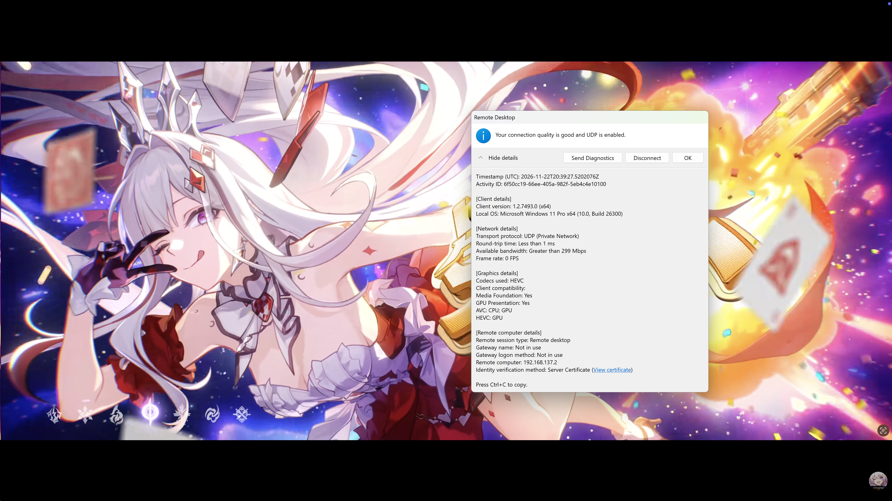

# S' MacRDP

[](https://github.com/SurakTH/macrdp/releases)
[](https://github.com/clintcan/macrdp/releases/latest)
[](#license)
[](https://ko-fi.com/clintcan)

A native RDP server for macOS, written in Rust on top of [IronRDP]. Connect from `mstsc`, the Windows App / Microsoft Remote Desktop, or FreeRDP and drive your Mac — authenticated against your local Mac account (NLA/CredSSP, TLS). What you get:

- **Desktop:** H.264 video (hardware-encoded, opt-in, with optional adaptive bitrate) or legacy bitmaps; keyboard (non-US layouts auto-detected) and mouse with the real cursor shape; the session follows your client's resolution.
- **Clipboard & files:** text, images and rich text both ways; copy files and folders between Mac and Windows.
- **Audio:** Mac audio to the client; the client's microphone as a real Mac input device *(experimental)*.
- **Devices from the client:** drives mounted in Finder (read-write), smart cards for macOS apps, the webcam as a real Mac camera, and USB devices *(experimental)*.
- **Headless:** serve a virtual display so the Mac needs no monitor, with the physical screen blanked while you're connected.

This is the macOS equivalent of `xrdp`. Not a client, not a VNC bridge.

> [!NOTE]
> This is [SurakTH's fork](https://github.com/SurakTH/macrdp) of the original
> [clintcan/macrdp](https://github.com/clintcan/macrdp) project. The original
> authors and contributors retain full credit; fork-specific work and AI
> assistance are documented in [CREDITS.md](CREDITS.md).

## Status

v0 — daily-driver usable on a trusted LAN and over a VPN (ZeroTier, high-latency and mobile links included). Scope and limits: [Production readiness](#production-readiness).

## Fork releases

### v0.10.9.2

- **Experimental H.265 (HEVC)** adds 1080p/60, 1440p/60 and 4K/60 profiles for compatible Windows App clients. macrdp falls back to H.264 when supported by the client. The Controller's Performance tab shows the codec in use.
- **Video tuning** adds TCP pacing to the 4K/60 HEVC profile and increases the number of frames the Stable 1080p/60 H.264 profile can have in flight from one to two. HEVC at 4K/60 remains a preview.
- **Lower-latency PCM audio** adds an optional Core Audio Tap on macOS 14.2 and later. PCM sends audio in 10 ms packets, and the Tap path can queue up to 120 ms of audio during a brief TCP write stall. ScreenCaptureKit remains the default capture path, and AAC remains available as an option.

<details>
<summary>View screenshot from the H.265 (HEVC) 4K/60 test</summary>

Windows App's Connection Information shows HEVC as the active codec and lists GPU support for HEVC. The session used the experimental **4K HEVC profile** with a **60 FPS target**. Select the image to open the full-size screenshot.

[](docs/images/hevc-4k60-windows-app.png)

</details>

[Download v0.10.9.2](https://github.com/SurakTH/macrdp/releases/tag/v0.10.9.2) or read the [full release notes](docs/releases/v0.10.9.2.md). See the [video guide](docs/video.md) and [audio guide](docs/audio.md) for setup and testing details.

### v0.10.9.1

[Download v0.10.9.1](https://github.com/SurakTH/macrdp/releases/tag/v0.10.9.1) for the server and menu-bar Controller. This fork release builds on upstream v0.10.9.

- **Stable 1080p/60** uses H.264 AVC420 over TCP with a 60 Mbps adaptive bitrate target. Fast typing, document scrolling, restoring a minimized session and video playback with audio were tested over a wired connection.
- **Experimental 4K profiles** add a 4K/60 Preview with direct NV12 capture and a Sharp Text (LAN) preset with a higher bitrate target.
- **Controller and shortcuts** add a compact profile menu, a preview of settings changes before Apply, separate capture and TCP write timings, and improvements to Space switching, language switching and screenshot shortcuts.

See the [full v0.10.9.1 release notes](docs/releases/v0.10.9.1.md).

## Recent upstream releases

- **v0.10.7** (2026-11-20) — no frozen start on Windows 10 mstsc, an ack-lag cap, UDP out of experimental
- **v0.10.6** (2026-11-16) — no restart loop on a wrong password, a HiDPI virtual display, Windows 10 mstsc pictures
- **v0.10.5** (2026-11-13) — UDP multitransport fixes: mstsc's tunnel stays up, lossy audio plays again
- **v0.10.4** (2026-11-13) — true-colour cursors, native-style app switching, `--reverse-scroll`, pre-login timeout
- **v0.10.3** (2026-11-13) — Finder writes to redirected drives; the keyframe backoff works
- **v0.10.2** (2026-11-13) — no session freezes from Universal Clipboard items; no stuck drive mount after a restart
- **v0.10.1** (2026-11-12) — mstsc fixes: no drop after a blank-screen recovery, no adaptive-bitrate stutter on a LAN
- **v0.10.0** (2026-11-12) — IronRDP update: stalled-client timeout, iOS Windows App cursor, mute-on-minimize for FreeRDP/Thincast
- **v0.9.11** (2026-10-01) — input fixes: held modifiers on clicks, Ctrl+click→Cmd+click under `--map-ctrl-to-cmd`
- **v0.9.10** (2026-09-30) — microphone redirection *(experimental)*; `--lock-on-disconnect` no longer locks under a reconnecting client
- **v0.9.9** (2026-09-29) — rich-text clipboard in both directions
- **v0.9.8** (2026-09-27) — lock while away: `--lock-on-disconnect` + `--auto-unlock` *(experimental)*
- **v0.9.7** (2026-09-19) — security patch: rustls, cryptoki and h2 advisories
- **v0.9.6** (2026-08-16) — fixes a scroll-down regression and an unauthenticated denial of service
- **v0.9.5** (2026-08-06) — IronRDP update; two vendored forks retired
- **v0.9.4** (2026-08-05) — security hotfix for a pre-TLS denial of service
- **v0.9.3** (2026-07-29) — a second client takes over the session; blank-recovery storm-guard fix
- **v0.9.2** (2026-07-26) — blank recovery no longer drops a session that is working
- **v0.9.1** (2026-07-23) — `--shield-primary`: headless and still lockable
- **v0.9.0** (2026-07-20) — the client's webcam as a real Mac camera

Full per-release notes (what shipped, what was verified live, and the war stories): **[docs/release-history.md](docs/release-history.md)**.

## Production readiness

**For daily use**, start with the Controller's **Stable** profile, which uses H.264 at 1080p/60. Try the HEVC previews with a compatible Windows App client and check the active codec in the Controller's **Performance** tab.

S' MacRDP supports one active desktop session at a time. The Mac user must be logged in, and some protected windows and DRM video may appear black. Connect over a trusted LAN, VPN or RD Gateway. Keep the RDP port off the public internet.

See the [upstream readiness record](docs/production-readiness-roadmap.md) for historical soak tests and client coverage.

Rust is pinned to **1.95.0**, matching CI, in `rust-toolchain.toml`. When using
Homebrew Rust without rustup, select that version explicitly for reproducible
builds. The October hardening changes require reinstalling the smart-card IFD
handler together with the server; see [smart-card setup](docs/smart-card-redirection.md#ipc-authentication-and-upgrading).

## Quick start

### Install S' MacRDP from GitHub

1. On an Apple Silicon Mac running macOS 14 or later, download the DMG for a published release from [SurakTH/macrdp Releases](https://github.com/SurakTH/macrdp/releases). Drag both `macrdp.app` and `macrdp Controller.app` to Applications.
2. Open **macrdp Controller** from Applications. Select its display icon in the menu bar and choose **Start (first run sets up)**. Enter your Mac account password when prompted.
3. In **System Settings → Privacy & Security**, grant **Screen & System Audio Recording** and **Accessibility** to the installed `macrdp.app`. Restart the server from the Controller after granting permissions.
4. To connect from another computer on a trusted network, enable **Allow connections from the network** in the Controller and click **Apply**. In your RDP client, connect to `<your-mac-ip>:3390` using your Mac account.

If the server stops starting after an update or move, open the Controller's **Status** tab and choose **Repair Installation**.

### Homebrew for upstream macrdp

The [`clintcan/tap` Homebrew tap](https://github.com/clintcan/homebrew-tap) distributes the original macrdp. For S' MacRDP builds and fork-specific features, use the GitHub releases above.

### Connecting after a reboot

**After a reboot, someone has to log in before you can connect.** macrdp runs in your user session, which only starts once you log in, so it can't show the login screen ([#237](https://github.com/clintcan/macrdp/issues/237)). With FileVault on, no remote-desktop server can, since the disk unlocks before macOS starts any network service. To get in after a reboot, log in once with macOS Screen Sharing (VNC) and then connect over RDP. For a planned reboot with FileVault on, `sudo fdesetup authrestart` unlocks the disk for that one restart. Automatic login (System Settings › Users & Groups, FileVault off only) also works, at the cost of the Mac booting straight to an unlocked desktop.

### Run from source

```bash
./start.sh doctor   # read-only preflight; does not build or start the server
./start.sh   # auto-builds + ad-hoc signs when needed, then starts recommended mode
```

`doctor` checks macOS/build prerequisites, whether the optimized binary is
missing or stale, code signing, executable launcher bits, port 3390, free disk
space, and the active LAN address. Screen Recording and Accessibility remain
verified by macrdp itself at launch because macOS does not expose a reliable
read-only shell query for another binary's TCC grants.

Other presets: `./start.sh lan` for maximum practical quality on a clean LAN
(HiDPI AVC420, 60 FPS, 50 Mbps, stable TCP and uncompressed PCM audio), `./start.sh native`
for the sharpest HiDPI bitmap text/UI at a stable 12 FPS, or `./start.sh fast`
for the lowest-latency H.264 LAN setup. For a manual build,
run `cargo build --release && codesign -s - --force target/release/macrdp`.

Native is the Windows-like RemoteFX/QOI tile path: `mstsc` normally negotiates
RemoteFX, FreeRDP commonly uses QOIZ/QOI, and some Windows App versions use
NSCodec. The server automatically falls back to bitmap/RLE when needed.

First run will prompt for:
1. **Screen Recording permission** (System Settings → Privacy & Security → Screen Recording → enable `macrdp` → restart it).
2. **Accessibility permission** (same path, "Accessibility" — required to forward keyboard and mouse).
3. Your Mac password at the terminal — validated against your local account via PAM `checkpw`, then used as the RDP credential.

Then connect from a client to `<your-mac-ip>:3390` with your Mac username and password. `mstsc` will prompt for credentials in its own NLA dialog — no need to pre-type the username.

Common flags to try next (full reference: [docs/configuration.md](docs/configuration.md)):

```bash
./macrdp --enable-h264                      # H.264 video — smoother and lighter than the default bitmaps
./macrdp --enable-h264 --avc444             # Experimental diagnostics only; known live color corruption
./macrdp --enable-h264 --adaptive-bitrate   # + congestion-responsive rate control (recommended off-LAN)
./macrdp --bind 0.0.0.0:3390                # accept LAN connections (keep it OFF public IPs)
./macrdp --virtual-display --width 2560 --height 1440   # headless second desktop; local screen untouched
./macrdp --map-ctrl-to-cmd                  # Windows Ctrl+C/V/X muscle memory drives macOS copy/paste
```

## Hotkeys

macrdp reimplements the macOS symbolic hotkeys in user space (WindowServer won't fire them for forwarded events). On a **Windows client the Cmd key is the Windows key**, so press the Win-key equivalent:

| Keys (on the client) | Action |
|---|---|
| **Cmd+Tab** / **Cmd+Shift+Tab** | Cycle apps (forward / back); the app you land on is surfaced |
| **Cmd+\`** / **Cmd+Shift+\`** | Cycle windows of the current app |
| **Cmd+Space** | Spotlight |
| **Cmd+Shift+3 / 4 / 5** | Screenshots (full screen / region / Screenshot.app) |
| **Ctrl+↑ / ↓** | Mission Control / windows of the current app |
| **Ctrl+← / →** | Previous / next desktop Space |
| **Ctrl+Alt+G** | Gather windows stranded off the virtual display (headless `--capture-primary`/`--detach-primary` modes) |
| **Ctrl+Alt+Shift+R** | On-demand A/V resync — repaint a stale/idle-blanked screen (forced keyframe) and re-sync drifted audio, without disconnecting. Handy for mstsc after hours idle. |

Optional flags: `--alt-tab-switch` / `--alt-backtick-switch` / `--alt-space-spotlight` accept **Option+Tab** / **Option+\`** / **Option+Space** as the same triggers; `--alt-q-quit` sends **Option+Q** (Alt+Q from the client) as **Cmd+Q** to quit apps; `--app-switcher-hud` draws a visible switcher overlay; `--map-ctrl-to-cmd` remaps Windows **Ctrl+C/V/X/…** editing shortcuts to their **Cmd** equivalents.

> **mstsc tip:** if **Cmd+Tab** seems ignored, set **Local Resources → Keyboard → "Apply Windows key combinations"** to **"On the remote computer"** (or go full-screen) — the windowed default eats **Win+Tab** locally as Task View.

## Auto-start at login (launchd)

The bundled Controller manages the fork's LaunchAgent, `io.github.surakth.macrdp`. To restart that service from Terminal, run:

```bash
launchctl kickstart -k "gui/$(id -u)/io.github.surakth.macrdp"
```

For a command-line installation, use the standalone installer below. Run just one installation on port 3390.

```bash
dist/install.sh
```

Builds + signs + installs to `~/.local/bin/macrdp`, stores your Mac password in the macOS Keychain under service `macrdp`, drops a launchd plist at `~/Library/LaunchAgents/com.user.macrdp.plist`, and loads it. macrdp will start on every login and restart if it crashes. Re-run the script after `cargo build --release` to refresh the installed binary.

```bash
launchctl print gui/$UID/com.user.macrdp | head    # status
launchctl kickstart -k gui/$UID/com.user.macrdp    # restart
launchctl bootout gui/$UID/com.user.macrdp         # unload the agent
```

## Building the full app

`dist/install.sh` installs a bare binary. For a proper **signed `macrdp.app`** — bundle identity, background-agent behavior, the embedded smart-card IFD handler, optional notarization, the menu-bar controller app, and a distributable DMG:

```bash
packaging/make-app.sh                                 # build + sign + install to /Applications
gui/make-tray-app.sh                                  # build + install macrdp Controller
open "/Applications/macrdp Controller.app"            # click Start; onboarding is in the app
```

The Controller includes the Stable profile and presets for LAN, bitmap and
experimental video modes. Network settings can restrict access to specific
client IP addresses. Feature toggles, bind address, and extra flags live in
`~/Library/Application Support/macrdp/config.env` — outside
the bundle, so edits never disturb the signature or TCC grants. The full
Controller self-installs the LaunchAgent and repairs an obsolete executable path
after either app is moved or replaced; **Repair Installation** on Status reruns
the same safe reconciliation without deleting config, TLS data, or Keychain
credentials. Start/Stop/Restart run off the UI thread and report verified launchd
results instead of leaving the window blocked. The full
packaging guide (Developer-ID signing, notarization, the DMG, the controller
app, icons, TCC notes): **[packaging/README.md](packaging/README.md)**.

## Release artifacts

The fork's [release workflow](.github/workflows/release.yml) builds these downloads for Apple Silicon (`aarch64-apple-darwin`) when a version tag is pushed.

| File | What's included |
|------|-----------------|
| `macrdp-<ver>-aarch64-apple-darwin.dmg` | `macrdp.app` and `macrdp Controller.app`, with an Applications shortcut |
| `macrdp-<ver>-aarch64-apple-darwin.tar.gz` | Standalone CLI binary and project documentation |
| `macrdp-<ver>-aarch64-apple-darwin-app.zip` | Server app bundle, including the smart-card IFD handler and installer |
| `SHA256SUMS` | SHA-256 checksums for the downloadable files |

The fork's CI builds are ad-hoc signed and ship without Apple notarization. If macOS blocks a trusted download, follow [Apple's app-opening instructions](https://support.apple.com/en-us/102445). For Developer ID signing, notarization or an entitled USB build, see the [packaging guide](packaging/README.md).

## Documentation

| Guide | What's in it |
|-------|--------------|
| **[Performance & quality tuning record](docs/performance-quality-tuning.md)** | Consolidated record of the H.264 zero-copy/allocation work, Native HiDPI bitmap tuning, codec-quality choices, launcher behavior, trade-offs, and verification status. |
| **[Configuration & CLI](docs/configuration.md)** | Every flag, the auth-hardening environment variables (rate-limit/lockout/audit), headless mode (`--virtual-display`, `--detach-primary`/`--capture-primary`), and a full set of example invocations. |
| **[Video](docs/video.md)** | The H.264/EGFX pipeline, Retina capture (`--hidpi`), client-resolution auto-adopt and letterboxing, bitrate/keyframe tuning, the mstsc reconnect-blank quirk and its in-place auto-recovery, and the vImage color-conversion benchmarks. |
| **[Audio](docs/audio.md)** | RDPSND PCM, opt-in AAC compression (`--enable-aac`), the self-healing capture stream, mute-on-minimize — and the experimental **microphone redirection** (`--enable-microphone-redirection`): the client's mic as a real macOS input device. |
| **[File copy](docs/file-copy.md)** | Mac↔Windows clipboard file copy (files and folder trees), lazy vs eager paste, and the two Windows-side gotchas (Explorer folder-copy, archive shell extensions). |
| **[Drive redirection](docs/drive-redirection.md)** | Mounting the client's drives as read-write Finder volumes (`--enable-drive-redirection`) — how the in-process NFS bridge works and what to expect from permissions. |
| **[Camera redirection](docs/camera-extension-setup.md)** | Presenting the client's **webcam as a real macOS camera** (`--enable-camera-redirection`) — the one-time system-extension setup and activation, how the MS-RDPECAM → VideoToolbox → CoreMediaIO pipeline fits together, and the four CoreMediaIO failure modes that all fail *silently*. **For a webcam use this, not USB redirection** — it's the path mstsc feeds. |
| **[Smart-card redirection](docs/smart-card-redirection.md)** | Using the client's smart card from macOS apps (`--enable-smartcard-redirection`) — one-time IFD-handler install, the USB-trigger caveat, upgrade/reload notes, and why it's a user-space handler rather than USB passthrough. |
| **[Audit log & SIEM](docs/audit-log.md)** | The security audit events (accept / reject / auth / disconnect) — every field and how to interpret them — plus [forwarding the JSON stream](docs/siem-forwarding.md) to a SIEM/SOC collector (Vector / Fluent Bit / rsyslog) and a runnable [OpenSearch SIEM tutorial](docs/siem-tutorial.md) that detects an RDP brute-force end-to-end. |
| **[vs. other OSS RDP servers](docs/oss-rdp-server-comparison.md)** | Two parts. **Part 1** — the evidence behind every "first" claim in these docs, verified adversarially against FreeRDP/xrdp and re-checked in the source, including what macrdp is **not** first at and how to re-verify when upstreams move. **Part 2** — an honest head-to-head against the other native macOS RDP servers (`x6nux/macrdp`, `RDPonMAC`), written steelmanning theirs, including where they beat us. |
| **[Release history](docs/release-history.md)** | Per-release narrative of what shipped and what was live-verified. |
| [CLAUDE.md](CLAUDE.md) | Developer/agent index — current release, plus pointers to the feature list, architecture, macOS gotchas and known quirks. |

## Why this was made

This was done to scratch an itch. There are practically no active open source RDP servers for macOS. The closest project with this functionality is xrdp; however it only runs on Linux/Unix machines and has no homebrew equivalent on Macs. The initial POC was done in a few hours with the help of Claude and ran pretty well from the start. Additional combing through pcap files and documentation, and debugging each mstsc/FreeRDP connect, is what makes this work tedious yet rewarding when it finally works. Multi-monitor support is on the list for when I'm bored or need a distraction from real life.

## Support this project

macrdp is free and open source. If it's helped you out, you can buy me a coffee to help me get through the bumps — totally optional, no pressure.

- ☕ **[Buy me a coffee on Ko-fi](https://ko-fi.com/clintcan)**

## License

Licensed under either of [MIT](LICENSE-MIT) or [Apache-2.0](LICENSE-APACHE) at your option. Being permissively licensed, a productized/notarized build may be sold commercially with support — that's selling the product, not a license exemption.

[IronRDP]: https://github.com/Devolutions/IronRDP
